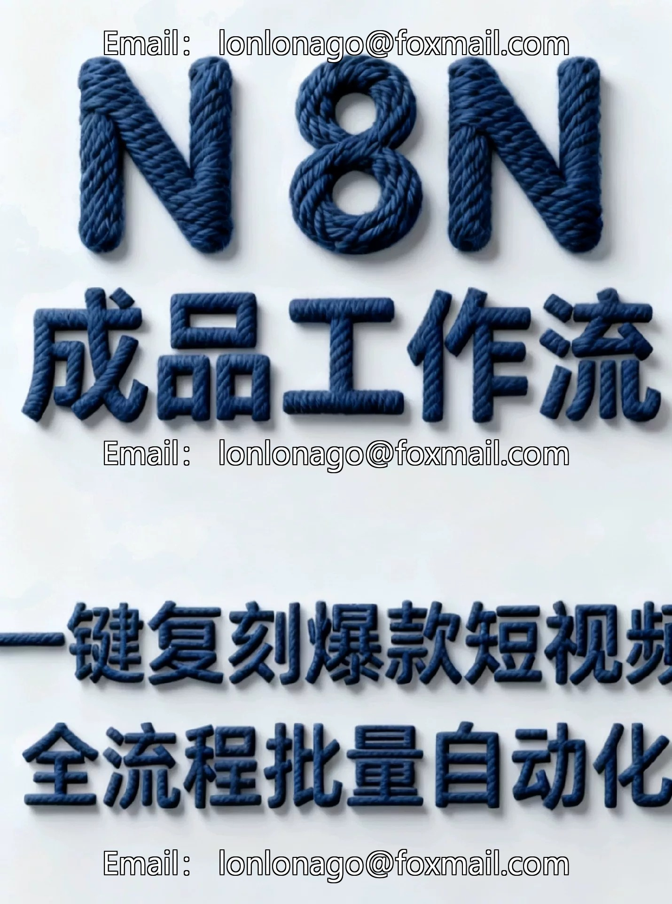
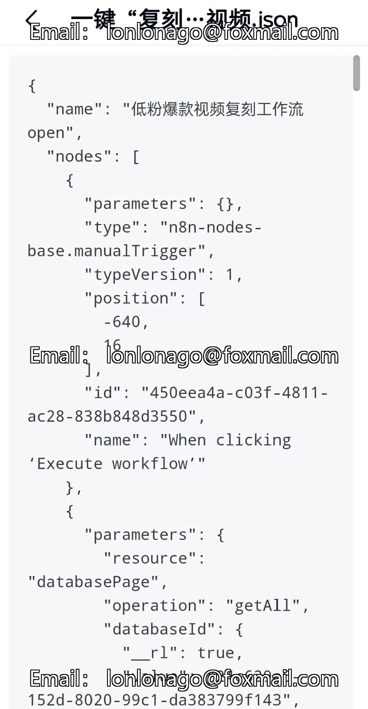
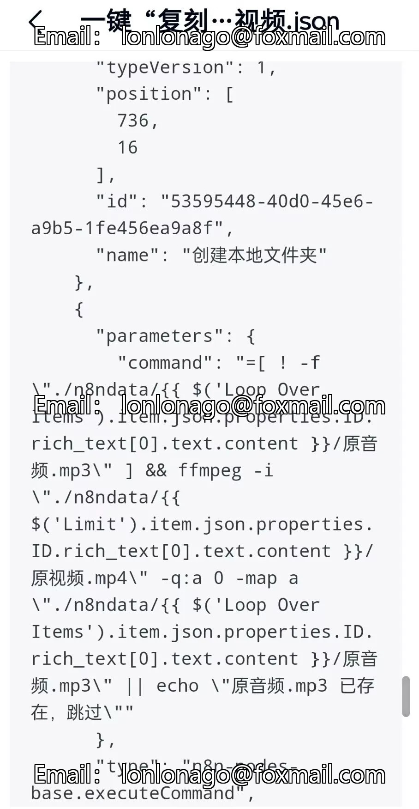

# N8N finished product workflow]: Instantly recreate a popular short video with one click, fully automated throughout the entire process.

## Body

N8N finished product workflow]: A one-click replica of a popular short video, a full-process batch automation production system, can achieve efficient start-up even without technical knowledge.

Read before shooting

- This product is digital and does not support returns once sold. Please carefully read the text and images to confirm your needs and "n8n operational capabilities" before placing an order.
- The product does not include Q&A service. If you have any questions during use, you can refer to the accompanying tutorials for assistance.
- The template does not include platform account credentials or API keys (such as the call key for large models), and users must prepare the corresponding API credentials when using related services.
- For technical support, an additional symbolic fee is charged, or you can purchase other N8N video courses from this store for self-study.

Still worried about the long time spent on "human disassembly of blockbusters" and the low efficiency of "mass production breaks"? This N 8 N product workflow directly addresses the pain points of short video production, focusing on "parameterized replication + full-link automation" as its core. Coupled with exclusive instructional videos, it empowers the entire process from setup to implementation, enabling novice bloggers and mass account creation teams to quickly achieve "blockbuster mass production."

In conjunction with our other workflow "Fully Automated TikTok Low Follower Viral Video Collection Workflow", this complements the low-follower accounts to earn traffic effortlessly.

1. Core Workflow Capabilities: Professional-Grade Replicating and Automated Production, Mastering the Logic of Mass Producing Short Videos

As a standardized finished product workflow, it does not require independent development and can be immediately activated with full-process automation production links. The core advantage focuses on three major professional modules.

1. Structured Replicating of Popular Products: The system automatically extracts the "structured parameters" (including camera rhythm, subtitle timing, BGM track layering, and sticker animation coordinates) from popular videos on Douyin/TikTok, generating a replicating parameter template that can be directly reused;
By clicking "One-Click Replicating," the template parameters can be synchronized to the editing module, preventing the failure of replication due to missed key details during manual disassembly.
2. Full-process Bulk Task Automated Scheduling: An in-built bulk task queue management module supports the creation of production tasks for more than 10+ accounts simultaneously, configuring an automated execution chain for "video generation - subtitle matching - BGM embedding - watermark addition."

The system will automatically schedule resources based on "task priority" to achieve "multi-account, multi-batch" video parallel production without the need for manual sequential operations.
3. Mass Production Quality Automated Inspection: The mass production process is integrated with a video compliance and hit-rate adaptability inspection module, automatically checking picture clarity and subtitle accuracy. At the same time, it compares "core parameters of the replica template" (such as camera switch frequency and interactive guidance phrase position), eliminating products that do not meet the "hit-rate threshold", ensuring that the quality of batch output can be controlled.

II. Workflow Setup and Activation: Complete professional-level configuration in three steps, with no barriers to terminology implementation.

Activate fully automated production without the need for technical team support, following standardized processes that match professional operational logic.

1. Workflow Initialization and Account Mapping: Log in to the workflow back-end, navigate to "System Configuration Module", complete the API integration between the workflow and editing tools (supported by mainstream editing software), then proceed to the "Account Management" page, add a Douyin/TikTok account and complete production permission configuration, achieving the linkage of "Workflow - Account - Editing Tool".
2. Replicating Parameter Template Customization and Storage: Enter the "Template Management Center", upload a target popular video or input a popular video link, the system will automatically complete the parameter structured parsing and generate an "Editable Replica Template";
Customize details such as "Lens Duration Ratio" and "Subtitle Font Parameters" etc., save it and incorporate into the template resource library for subsequent batch calls.

3. Mass Production Link Activation and Task Deployment: Create mass production tasks in the "Task Scheduling Center", select the target "Replica Template" or "Related Accounts", configure "Production Quantity" and "Automated Quality Assurance Threshold" (such as "Parameter Matching ≥ 90%"), click "Deploy Task", the system will automatically initiate the full process of automated production, and after completion, push to the corresponding account's "Publish Pending Library".

III. Exclusive Gift: Workflow Hands-On Use Teaching Video, Professional Operation Full Deconstruction

Core content coverage

- Decomposition of Core Modules in Workflow Backend: A detailed explanation of the "Task Scheduling Center" queue priority settings, "Template Resource Library" parameter classification management, and "Quality Assurance Module" threshold adjustment logic, enabling you to understand the "Mass Production Efficiency Logic" behind each function.
Batch Task Exception Troubleshooting Tutorial: Demonstrate troubleshooting steps for common issues such as "Task Queue Blocking", "API Interface Disconnection", and "Replica Parameter Matching Failure". Include tutorials on the use of linked tool to ensure uninterrupted mass production.
- Replicate participant

## Images

## Payment

Here is a pay link on Stripe ( https://buy.stripe.com/3cs8yP7sY87d0vu9AB ). Please contact me lonlonago@foxmail.com after funding $89, and I will send you a complete data files , thank you!

